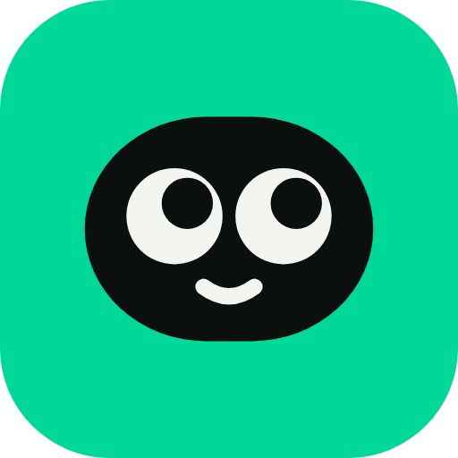

<p align="center">
  
</p>

<h1 align="center">Meno.chat</h1>

<p align="center"><b>An AI that <s>gives you answers</s> <i>actually</i> helps you learn.</b></p>

Meno is an open-weight tutoring model. It is being built to give hints and ask questions instead of handing over answers, and to do well on [TutorBench](https://arxiv.org/abs/2510.02663), a benchmark of tutoring ability for high-school and AP-level STEM.

The name comes from Plato's *Meno*, where Socrates guides a boy to a geometry proof by asking questions alone.
> **Status: in development. No model, dataset, or benchmark result has been released yet.**

## Goals
- Fine-tune an open vision-language base model for tutoring: adaptive explanations, feedback on student work, and hints that don't give away the answer.
- Release the weights, training data recipe, and evaluation code openly.
- Report results honestly, including TutorBench once its full set is available.

## Evaluation integrity
- We do **not** train on TutorBench test samples. The 30 public samples are used only to understand the format.
- We build our own held-out eval and use the official benchmark only as a final check.
- Any reported score will state exactly how it was produced.

## Roadmap
- [ ] Phase 0: Learn the basics and read the TutorBench paper
- [ ] Phase 1: Build an eval (own prompts, rubrics, judge script, baselines)
- [ ] Phase 2: Choose a vision-language base model
- [ ] Phase 3: Generate and filter training data
- [ ] Phase 4: LoRA fine-tuning, then preference tuning
- [ ] Phase 5: Evaluate, iterate, and release (weights on Hugging Face, code here, model card)

## Repository layout
| Path | Contents |
|---|---|
| `scripts/` | Helper scripts, for example downloading the public TutorBench samples |
| `data/` | Local datasets (not committed) |
| `brand/` | Brand guidelines page and exported logos |

## Getting started
```bash
python3 -m venv .venv && source .venv/bin/activate
pip install -r requirements.txt
python scripts/download_samples.py   # public TutorBench subset, for format reference only
```

Copy `.env.example` to `.env` for any API keys. Never commit `.env`.

## Contributing
See [CONTRIBUTING.md](CONTRIBUTING.md).

## License
Code and documentation are released under the [Apache License 2.0](LICENSE). Model weights, when released, will carry the license required by their base model, which will be stated in the model card.

The Meno name and logo are not covered by the code license.
